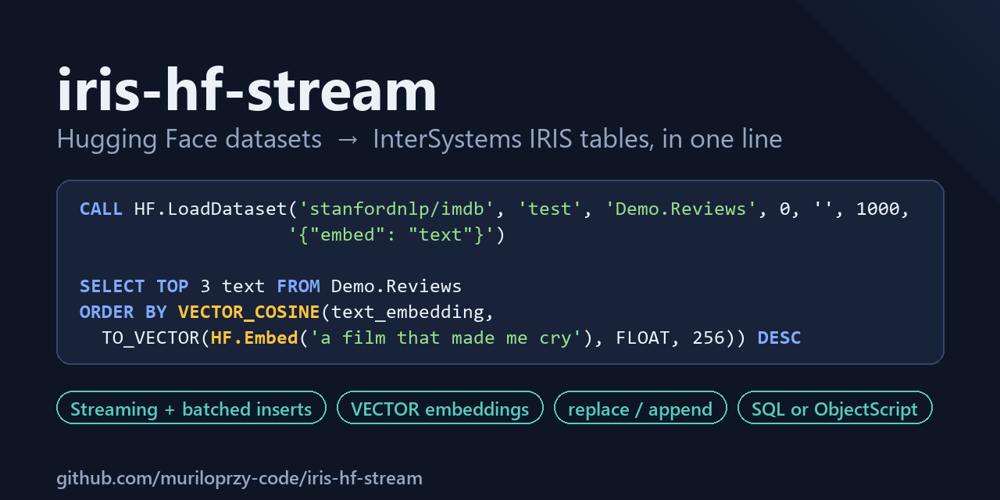
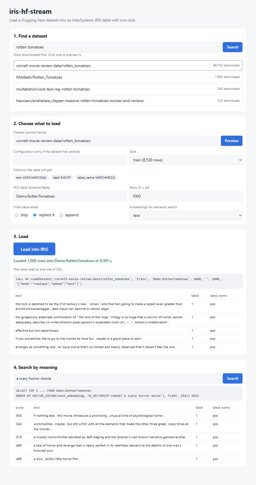

# iris-hf-stream



[](https://github.com/muriloprzy-code/iris-hf-stream/actions/workflows/tests.yml)

Load a [Hugging Face](https://huggingface.co/datasets) dataset into an InterSystems IRIS table with **one click** in a web page served by IRIS, or with **one line** of SQL or ObjectScript. It streams the dataset, so it only downloads the rows you ask for, and it inserts them in batches. It can also add a `VECTOR` column of text embeddings, so the data is ready for semantic search in IRIS SQL.

```sql
CALL HF.LoadDataset('stanfordnlp/imdb', 'train', 'Demo.Imdb', 1000)
```

```objectscript
write ##class(HF.Loader).Load("stanfordnlp/imdb", "train", "Demo.Imdb", 1000)
```

```sql
-- with embeddings: the 3 reviews closest in meaning to a sentence
CALL HF.LoadDataset('stanfordnlp/imdb', 'test', 'Demo.ImdbVec', 0, '', 1000, '{"embed": "text"}')
SELECT TOP 3 label_name, SUBSTRING(text, 1, 80) FROM Demo.ImdbVec
ORDER BY VECTOR_COSINE(text_embedding, TO_VECTOR(HF.Embed('a heartwarming family film that made me cry'), FLOAT, 256)) DESC
```

This project implements the community idea **DPI-I-543 – "Load datasets from Hugging Face into IRIS"**.

**Features at a glance**

- One click in the web page at `/hfstream/`: search the Hub, preview the columns, load with live progress, then search by meaning.
- One call from ObjectScript or SQL (`CALL`, Management Portal, JDBC, ODBC); always returns JSON, never throws.
- Streaming download (`limit` rows only), batched inserts, clean rollback on failure.
- Column types inferred from a sample, widened automatically when a later row does not fit.
- `mode`: fail, replace (atomic swap) or append; `columns` to load only some; `split = "all"` for every split.
- Readable class labels (`label_name`), media columns (images, audio) left out and reported, SQL-safe column names.
- Optional `VECTOR` embeddings plus an `HF.Embed()` SQL function for semantic search.
- `Search` and `Info` to find datasets and see their splits and columns before loading.
- Actionable error messages for the usual Hugging Face mistakes (missing `owner/`, missing config, gated dataset).
- Tested: 103 Python tests (SQLite stand-in) and 12 ObjectScript tests inside IRIS (loader and web API), run by GitHub Actions on every push.

## Why another loader

| | Typical approach | iris-hf-stream |
| --- | --- | --- |
| Download | Whole dataset first, `limit` applied afterwards | Streaming: `load_dataset(..., streaming=True)` + `take(limit)` |
| Insert | One row at a time | Batches of ~1000 rows, one transaction per batch |
| Text columns | Fixed `VARCHAR(4000)` | `VARCHAR(n)` sized from a sample, `LONGVARCHAR` for long text, widened on the fly if needed |
| Reloading | Drop the table by hand | `mode`: `replace` (new table swapped in at the end) or `append` |
| Images / audio | Stored as garbage text, or the load fails | Left out before reading, listed in `skipped_columns` |
| AI use | Export to another tool | `VECTOR` embeddings in the same load, searched with `VECTOR_COSINE` |
| Interface | ObjectScript class | One-click web page, ObjectScript class **and** SQL stored procedure (usable from the Management Portal, JDBC, ODBC) |
| Dependencies | Unpinned | Pinned in `requirements.txt` |

## Quick start

Requirements: Docker. The image is built on `intersystemsdc/iris-community:latest`.

```bash
git clone https://github.com/muriloprzy-code/iris-hf-stream.git
cd iris-hf-stream
docker compose up -d --build
```

Then open **<http://localhost:52773/hfstream/>** and log in with an IRIS user (`_SYSTEM` or `SuperUser`, password `SYS` in this development image). Search for a dataset, click it, click **Load into IRIS**.

Or open an IRIS terminal in the `USER` namespace:

```bash
docker compose exec iris iris session IRIS -U USER
```

```objectscript
USER> write ##class(HF.Loader).Load("stanfordnlp/imdb", "train", "Demo.Imdb", 1000), !
{"status":"ok","table":"Demo.Imdb","rows_loaded":1000,"seconds":...,"columns":[...]}
```

Or use SQL, for example in the Management Portal (<http://localhost:52773/csp/sys/UtilHome.csp>, user `SuperUser`, password `SYS`; **System Explorer → SQL**, namespace `USER`):

```sql
CALL HF.LoadDataset('stanfordnlp/imdb', 'train', 'Demo.Imdb', 1000)
SELECT TOP 5 * FROM Demo.Imdb
```

### Install with ZPM / IPM

```objectscript
zpm "install iris-hf-stream"
```

The Python dependencies are not installed by the module; install them once with IRIS's own Python:

```bash
irispython -m pip install --target <install-dir>/mgr/python -r requirements.txt
```

The module also creates the `/hfstream` web application in the namespace it is installed in.

Outside Docker (for example IRIS on Windows), see [Troubleshooting](#troubleshooting-outside-docker).

> **Port already in use?** If an IRIS installed on the host already listens on 52773 (or 1972), the browser reaches that one instead of the container and `/hfstream/` answers *Not Found*. Pick other host ports: `IRIS_WEB_PORT=52780 IRIS_PORT=1980 docker compose up -d`, then open <http://localhost:52780/hfstream/>.

## Demo walkthrough

This section walks through a complete session, from an empty IRIS instance to SQL queries over real Hugging Face data. Every command was run on IRIS Community 2026.1 with `datasets` 5.1.0. The outputs shown are the real ones; only the `seconds` values change from run to run.

### 1. Start IRIS

```bash
git clone https://github.com/muriloprzy-code/iris-hf-stream.git
cd iris-hf-stream
docker compose up -d --build
docker compose exec iris iris session IRIS -U USER
```

The build installs the Python dependencies (`datasets`, `model2vec`, ...) into IRIS's embedded Python directory, downloads the default embedding model (about 30 MB) and compiles the `HF` package. Nothing else needs to be installed on the host.

> The compose file starts IRIS with `/iris-main` instead of the image's default entrypoint, because the default entrypoint's post-start hook fails on the 2026.1 image and shuts IRIS down. The `USER` namespace that hook would create already exists.

### 2. Or just click: the web page

Open <http://localhost:52773/hfstream/> and log in with an IRIS user (`_SYSTEM` / `SYS` in this image). The page is served by IRIS itself (class `HF.REST`), with no other software to install.

1. **Find a dataset.** Type a word and press *Search*: the Hub's datasets, most downloaded first.
2. **Click one.** The page reads a sample and fills in the rest: the splits with their sizes, the columns and SQL types the table will get, and a table name (`Demo.RottenTomatoes`). Change anything you like: the number of rows, *replace* or *append* if the table exists, and a text column to embed.
3. **Click *Load into IRIS*.** The load runs in a background job, so even a long one is not cut by the web server timeout. The page shows the seconds and the rows written so far, then the first rows of the new table and **the same load as one line of SQL**, ready to copy.
4. **Search by meaning.** If you chose a column to embed, type a sentence: the page shows the closest rows with their cosine score, and the SQL it ran.



Everything the page does goes through the same `HF.Loader` methods as the next steps, so the result is the same as typing the commands. The rest of this walkthrough uses the terminal and SQL.

### 3. Find a dataset and preview it

`Search` asks the Hub for datasets matching a word, most downloaded first:

```objectscript
USER> write ##class(HF.Loader).Search("sentiment", 5), !
{"status": "ok", "term": "sentiment", "results": [
  {"id": "zeroshot/twitter-financial-news-sentiment", "downloads": 7192, "likes": 191},
  {"id": "mteb/tweet_sentiment_extraction", "downloads": 5159, "likes": 38},
  {"id": "stanfordnlp/sentiment140", "downloads": 4258, "likes": 31},
  {"id": "google-research-datasets/poem_sentiment", "downloads": 2070, "likes": 19},
  {"id": "cardiffnlp/tweet_sentiment_multilingual", "downloads": 1985, "likes": 25}]}
```

Then check what table a dataset would produce, without writing anything. `Info` streams the first 1000 rows, infers the column types, and adds the split sizes published on the Hub:

```objectscript
USER> write ##class(HF.Loader).Info("stanfordnlp/imdb", "train"), !
{"status": "ok", "dataset": "stanfordnlp/imdb", "split": "train", "sampled_rows": 1000,
 "columns": [{"name": "text", "source": "text", "type": "LONGVARCHAR"},
             {"name": "label", "source": "label", "type": "BIGINT"},
             {"name": "label_name", "source": "label_name", "type": "VARCHAR(32)"}],
 "splits": {"train": 25000, "test": 25000, "unsupervised": 50000},
 "download_bytes": 83446840, "dataset_bytes": 133190302}
```

From SQL: `SELECT HF.SearchDatasets('sentiment', 5)` and `SELECT HF.DatasetInfo('stanfordnlp/imdb')`.

The movie reviews are long (up to about 6000 characters), so `text` becomes `LONGVARCHAR` instead of a fixed `VARCHAR`. The integer `label` becomes `BIGINT`.

`label_name` is not in the original data. The dataset's metadata says `label` is a class label with the names `neg` and `pos`, so the loader adds a readable text column next to the number. This happens for every `ClassLabel` column, so you can query `WHERE label_name = 'pos'` instead of remembering what `1` means.

### 4. Load 1000 rows with one line of ObjectScript

```objectscript
USER> write ##class(HF.Loader).Load("stanfordnlp/imdb", "train", "Demo.Imdb", 1000), !
{"status": "ok", "table": "Demo.Imdb", "mode": "fail", "rows_loaded": 1000, "seconds": 3.061,
 "columns": [{"name": "text", "type": "LONGVARCHAR"}, {"name": "label", "type": "BIGINT"},
             {"name": "label_name", "type": "VARCHAR(32)"}]}
```

That one call did the following:
1. opened the dataset in streaming mode and downloaded only enough data for 1000 rows (not the full 25,000-row split);
2. created `Demo.Imdb` with the inferred columns;
3. inserted the rows with a prepared statement, one transaction per 1000-row batch.

The table is a normal IRIS SQL table:

```sql
SELECT AVG(CHARACTER_LENGTH(text)) AS avg_chars, MAX(CHARACTER_LENGTH(text)) AS max_chars FROM Demo.Imdb
-- avg_chars  max_chars
-- 1311.289   6103

SELECT TOP 3 label, label_name, SUBSTRING(text, 1, 50) AS preview FROM Demo.Imdb
-- 0  neg  I rented I AM CURIOUS-YELLOW from my video store b
-- 0  neg  "I Am Curious: Yellow" is a risible and pretentiou
-- 0  neg  If only to avoid making this type of film in the f
```

`LONGVARCHAR` columns are stored as character streams. Use `SUBSTRING(column, 1, n)` when you want the text itself in a result set, for example from Embedded Python, where a plain `SELECT` returns the stream reference.

> **`limit` takes the first rows in file order.** The IMDB `train` split is sorted by label, so the first 1000 rows are all negative reviews (`label = 0`). Use `limit = 0` to load the whole split, or pick a split or dataset that is already shuffled.

### 5. Load a whole split from SQL

The same loader is exposed as a SQL stored procedure. That means it can be called from the Management Portal (**System Explorer → SQL**, namespace `USER`, user `SuperUser` / password `SYS`), or from any JDBC or ODBC client connected to port 1972:

```sql
CALL HF.LoadDataset('stanfordnlp/imdb', 'train', 'Demo.ImdbFull', 0)

SELECT %EXACT(label_name) AS label_name, COUNT(*) AS reviews
FROM Demo.ImdbFull GROUP BY %EXACT(label_name)
-- label_name  reviews
-- neg         12500
-- pos         12500
```

`%EXACT` keeps the original case. Without it, IRIS groups `VARCHAR` values case-insensitively and shows them in upper case (`NEG`, `POS`).

With `limit = 0`, all 25,000 reviews were loaded in about 8 seconds, download included (same test machine as the [Benchmark](#benchmark)). To keep a default from SQL, pass `''` (for example `CALL HF.LoadDataset('stanfordnlp/imdb', '', 'Demo.T', 100)` uses the `train` split).

### 6. Different kinds of data

**Booleans become `BIT`.** In BoolQ, each question has a yes/no answer:

```objectscript
USER> write ##class(HF.Loader).Load("google/boolq", "train", "Demo.BoolQ", 500), !
{"status": "ok", "table": "Demo.BoolQ", "mode": "fail", "rows_loaded": 500, "seconds": 2.278,
 "columns": [{"name": "question", "type": "VARCHAR(512)"}, {"name": "answer", "type": "BIT"},
             {"name": "passage", "type": "LONGVARCHAR"}]}
```

```sql
SELECT answer, COUNT(*) AS n FROM Demo.BoolQ GROUP BY answer
-- answer  n
-- 0       184
-- 1       316
```

Short text columns get a `VARCHAR(n)` sized from the sample (here `question` → `VARCHAR(512)`). Long ones get `LONGVARCHAR` (`passage`).

**Nested values become JSON.** In SQuAD, the `answers` column is a dictionary of lists. It is stored as JSON text, which IRIS SQL can unpack with `JSON_TABLE`:

```objectscript
USER> write ##class(HF.Loader).Load("rajpurkar/squad", "train", "Demo.Squad", 500), !
{"status": "ok", "table": "Demo.Squad", "mode": "fail", "rows_loaded": 500, "seconds": 3.105,
 "columns": [{"name": "id", "type": "VARCHAR(128)"}, {"name": "title", "type": "VARCHAR(128)"},
             {"name": "context", "type": "LONGVARCHAR"}, {"name": "question", "type": "VARCHAR(1024)"},
             {"name": "answers", "type": "LONGVARCHAR"}]}
```

```sql
SELECT TOP 2 question, SUBSTRING(answers, 1, 80) AS answers FROM Demo.Squad
-- To whom did the Virgin Mary allegedly appear in 1858 in Lourdes France?  {"text": ["Saint Bernadette Soubirous"], "answer_start": [515]}
-- What is in front of the Notre Dame Main Building?                        {"text": ["a copper statue of Christ"], "answer_start": [188]}

SELECT TOP 3 s.question, j.answer
FROM Demo.Squad s,
     JSON_TABLE(SUBSTRING(s.answers, 1, 4000), '$.text[*]' COLUMNS (answer VARCHAR(200) PATH '$')) j
-- To whom did the Virgin Mary allegedly appear in 1858 in Lourdes France?       Saint Bernadette Soubirous
-- What is in front of the Notre Dame Main Building?                             a copper statue of Christ
-- The Basilica of the Sacred heart at Notre Dame is beside to which structure?  the Main Building
```

**Images and audio are left out, and reported.** A SQL column cannot hold a picture in a useful way, so media columns (`Image`, `Audio`, `Video`, `Pdf`) and raw binary columns are dropped before any row is read. The images are never decoded, so Pillow is not needed. The JSON result lists what was left out. In MNIST, that keeps the digit label:

```objectscript
USER> write ##class(HF.Loader).Load("ylecun/mnist", "train", "Demo.Mnist", 100), !
{"status": "ok", "table": "Demo.Mnist", "mode": "fail", "rows_loaded": 100, "seconds": 4.782,
 "columns": [{"name": "label", "type": "BIGINT"}, {"name": "label_name", "type": "VARCHAR(32)"}],
 "skipped_columns": ["image"]}
```

```sql
SELECT label_name, COUNT(*) AS n FROM Demo.Mnist GROUP BY label_name ORDER BY label_name
-- label_name  n
-- 0           13
-- 1           14
-- 2           6
-- ...
```

**Column names are made SQL-safe.** `lhoestq/demo1` has a column called `date`, which is a reserved word in IRIS SQL. The loader renames it to `date_`, so you can query it without quoting. Accents are removed (`preço` → `preco`), spaces and other symbols become `_`, and duplicate names get a numeric suffix.

```objectscript
USER> write ##class(HF.Loader).Load("lhoestq/demo1", "train", "Demo.Reviews", 0), !
{"status": "ok", "table": "Demo.Reviews", "mode": "fail", "rows_loaded": 5, "seconds": 1.643,
 "columns": [{"name": "id", "type": "VARCHAR(256)"}, {"name": "package_name", "type": "VARCHAR(128)"},
             {"name": "review", "type": "LONGVARCHAR"}, {"name": "date_", "type": "VARCHAR(64)"},
             {"name": "star", "type": "BIGINT"}, {"name": "version_id", "type": "BIGINT"}]}
```

```sql
SELECT TOP 3 star, date_, package_name FROM Demo.Reviews
-- 4  October 12 2016  com.mantz_it.rfanalyzer
-- 4  August 23 2016   com.mantz_it.rfanalyzer
-- 5  August 04 2016   com.mantz_it.rfanalyzer
```

**Datasets with several configurations.** Pass the configuration name as the fifth argument. GLUE, for example, has one configuration per task:

```objectscript
USER> write ##class(HF.Loader).Load("nyu-mll/glue", "validation", "Demo.Sst2", 200, "sst2"), !
{"status": "ok", "table": "Demo.Sst2", "mode": "fail", "rows_loaded": 200, "seconds": 2.159,
 "columns": [{"name": "sentence", "type": "VARCHAR(1024)"}, {"name": "label", "type": "BIGINT"},
             {"name": "idx", "type": "BIGINT"}, {"name": "label_name", "type": "VARCHAR(32)"}]}
```

```sql
SELECT TOP 2 label, label_name, sentence FROM Demo.Sst2
-- 1  positive  it 's a charming and often affecting journey .
-- 0  negative  unflinchingly bleak and desperate
```

If you forget the configuration, the error message lists the available ones (see the next step).

Missing values (`None` in Python) are stored as SQL `NULL` in every column type, and empty strings stay empty strings.

### 7. Semantic search with a VECTOR column

Add `{"embed": "text"}` to the options and every row also gets an embedding of its `text`, stored in a `VECTOR(FLOAT, 256)` column. The embeddings come from [model2vec](https://github.com/MinishLab/model2vec) (`minishlab/potion-base-8M` by default). It is a static embedding model that needs no GPU and no PyTorch, and it encodes thousands of texts per second, so it keeps up with a streaming load.

```objectscript
USER> write ##class(HF.Loader).Load("stanfordnlp/imdb", "test", "Demo.ImdbVec", 0, , , {"embed": "text"}), !
{"status": "ok", "table": "Demo.ImdbVec", "mode": "fail", "rows_loaded": 25000, "seconds": 23.929,
 "columns": [{"name": "text", "type": "LONGVARCHAR"}, {"name": "label", "type": "BIGINT"},
             {"name": "label_name", "type": "VARCHAR(32)"}, {"name": "text_embedding", "type": "VECTOR(FLOAT, 256)"}]}
```

All 25,000 reviews were downloaded, embedded and stored in 24 seconds. `HF.Embed(text)` embeds a query with the same model, so you can search by meaning straight from SQL:

```sql
SELECT TOP 3 label_name, SUBSTRING(text, 1, 80) AS review FROM Demo.ImdbVec
ORDER BY VECTOR_COSINE(text_embedding, TO_VECTOR(HF.Embed('a heartwarming family film that made me cry'), FLOAT, 256)) DESC
-- pos  Who will love my children has changed my heart, it made me cry all the way throu
-- pos  I am a 20 year old bloke from England. I don't cry at films. But this one moved
-- pos  I read the book before watching the movie and it left me emotionally drained but

SELECT TOP 3 label_name, SUBSTRING(text, 1, 80) AS review FROM Demo.ImdbVec
ORDER BY VECTOR_COSINE(text_embedding, TO_VECTOR(HF.Embed('a scary horror movie with lots of blood'), FLOAT, 256)) DESC
-- pos  I'm warning you -- this movie is not scary. If you're a horror movie fan, especi
-- pos  This movie is so awesome! I loved it, it was really scary. I love the Scream mov
-- pos  After the return of "horror movies" (come on Scream isn't scary!) i didn't have
```

The vectors also carry sentiment. Among the 200 reviews closest to a negative sentence, all 200 are negative; for a positive sentence, 199 of 200 are positive:

```sql
SELECT %EXACT(label_name) AS label_name, COUNT(*) AS n FROM (
  SELECT TOP 200 label_name FROM Demo.ImdbVec
  ORDER BY VECTOR_COSINE(text_embedding, TO_VECTOR(HF.Embed('the worst film I have ever seen, boring and awful'), FLOAT, 256)) DESC)
GROUP BY %EXACT(label_name)
-- neg  200

-- ... same query with 'a brilliant masterpiece, beautifully acted, I loved it'
-- neg  1
-- pos  199
```

Any other [model2vec model](https://huggingface.co/models?library=model2vec) can be used with `{"embed": "text", "embed_model": "<id>"}`; pass the same id to `HF.Embed(text, '<id>')` and use its dimension in `TO_VECTOR`.

### 8. Reload, append, every split, some columns

By default a load refuses an existing table. The `mode` option changes that:

```objectscript
USER> write ##class(HF.Loader).Load("cornell-movie-review-data/rotten_tomatoes", "train", "Demo.Rotten", 100), !
{"status": "ok", "table": "Demo.Rotten", "mode": "fail", "rows_loaded": 100, ...}

USER> write ##class(HF.Loader).Load("cornell-movie-review-data/rotten_tomatoes", "train", "Demo.Rotten", 100), !
{"status": "error", "code": "VALIDATION", "message": "table Demo.Rotten already exists; drop it first (DROP TABLE Demo.Rotten) or pass {\"mode\": \"replace\"} or {\"mode\": \"append\"} in the options"}

USER> write ##class(HF.Loader).Load("cornell-movie-review-data/rotten_tomatoes", "train", "Demo.Rotten", 200, , , {"mode": "replace"}), !
{"status": "ok", "table": "Demo.Rotten", "mode": "replace", "rows_loaded": 200, ...}

USER> write ##class(HF.Loader).Load("cornell-movie-review-data/rotten_tomatoes", "test", "Demo.Rotten", 50, , , {"mode": "append"}), !
{"status": "ok", "table": "Demo.Rotten", "mode": "append", "rows_loaded": 50, ...}
```

```sql
SELECT COUNT(*) FROM Demo.Rotten
-- 250
```

`replace` loads into a new table and swaps it in only at the end, so if the load fails the old table is still there, unchanged. `append` adds rows to the existing table; the dataset's columns must exist in it (use `columns` to pick them).

`split = "all"` loads every split into one table, with an `hf_split` column. `limit` then applies to each split:

```objectscript
USER> write ##class(HF.Loader).Load("cornell-movie-review-data/rotten_tomatoes", "all", "Demo.RottenAll", 0), !
{"status": "ok", "table": "Demo.RottenAll", "mode": "fail", "rows_loaded": 10662, "seconds": 8.529,
 "columns": [{"name": "text", "type": "LONGVARCHAR"}, {"name": "label", "type": "BIGINT"},
             {"name": "label_name", "type": "VARCHAR(32)"}, {"name": "hf_split", "type": "VARCHAR(32)"}],
 "rows_per_split": {"train": 8530, "validation": 1066, "test": 1066}}
```

`columns` loads only the columns you name. On the Hub's parquet files only those columns are read:

```objectscript
USER> write ##class(HF.Loader).Load("rajpurkar/squad", "train", "Demo.SquadQ", 2000, , , {"columns": ["title", "question"]}), !
{"status": "ok", "table": "Demo.SquadQ", "mode": "fail", "rows_loaded": 2000, "seconds": 3.289,
 "columns": [{"name": "title", "type": "VARCHAR(128)"}, {"name": "question", "type": "VARCHAR(1024)"}]}
```

If a later row does not fit the type chosen from the sample, the column is widened with `ALTER TABLE` and the load goes on. The result says what changed, for example `"widened_columns": [{"name": "text", "from": "VARCHAR(32)", "to": "VARCHAR(1048576)"}, {"name": "n", "from": "BIGINT", "to": "DOUBLE"}]`.

### 9. Errors come back as JSON, never as exceptions

`Load` never throws, so it is safe to call from SQL, from a production or from a scheduled task. Every problem is reported with a `code` and a message that says what to do next. The usual mistakes with Hugging Face datasets are recognized and explained:

```objectscript
USER> write ##class(HF.Loader).Load("imdb", "train", "Demo.Short", 10), !
{"status": "error", "code": "DOWNLOAD", "message": "dataset 'imdb' needs its full id in the form owner/name (for example 'stanfordnlp/imdb'); look it up at https://huggingface.co/datasets?search=imdb"}

USER> write ##class(HF.Loader).Load("nyu-mll/glue", "validation", "Demo.Glue", 10), !
{"status": "error", "code": "DOWNLOAD", "message": "dataset 'nyu-mll/glue' has several configurations; pass one as the config argument. Available: ax, cola, mnli, mnli_matched, mnli_mismatched, mrpc, qnli, qqp, rte, sst2, stsb, wnli."}

USER> write ##class(HF.Loader).Load("bigcode/the-stack", "train", "Demo.Gated", 10), !
{"status": "error", "code": "DOWNLOAD", "message": "dataset 'bigcode/the-stack' is gated: accept its terms at https://huggingface.co/datasets/bigcode/the-stack and set the HF_TOKEN environment variable for the IRIS process"}

USER> write ##class(HF.Loader).Load("stanfordnlp/imdb", "no_such_split", "Demo.Nope", 10), !
{"status": "error", "code": "DOWNLOAD", "message": "split not found in dataset 'stanfordnlp/imdb'. Available splits: train, test, unsupervised."}

USER> write ##class(HF.Loader).Load("no-such-user/no-such-dataset", "train", "Demo.Nope", 10), !
{"status": "error", "code": "DOWNLOAD", "message": "dataset 'no-such-user/no-such-dataset' was not found on the Hugging Face Hub; check the id (owner/name). If it is private, set the HF_TOKEN environment variable"}

USER> write ##class(HF.Loader).Load("stanfordnlp/imdb", "train", "Demo.Imdb", 10), !
{"status": "error", "code": "VALIDATION", "message": "table Demo.Imdb already exists; drop it first (DROP TABLE Demo.Imdb) or pass {\"mode\": \"replace\"} or {\"mode\": \"append\"} in the options"}

USER> write ##class(HF.Loader).Load("stanfordnlp/imdb", "train", "NoSchema", 10), !
{"status": "error", "code": "VALIDATION", "message": "invalid target 'NoSchema'; expected schema.table with letters, digits and underscores, starting with a letter"}
```

Existing tables are never overwritten. If a load fails halfway (for example a later row that does not fit the inferred type), the current batch is rolled back and the table created by that call is dropped, so nothing half-filled is left behind.

### 10. Measure batching

```objectscript
USER> do ##class(HF.Benchmark).Run("stanfordnlp/imdb", "train", 5000, 1000)
Warm-up (not timed)...
Bench.RowByRow  batchSize=1  status=ok  elapsed=3.91s
Bench.Batched  batchSize=1000  status=ok  elapsed=2.99s
```

See [Benchmark](#benchmark) for the numbers across 57 runs and how to read them.

### 11. Clean up

```sql
DROP TABLE Demo.Imdb
DROP TABLE Demo.ImdbFull
DROP TABLE Demo.BoolQ
DROP TABLE Demo.Squad
DROP TABLE Demo.Reviews
DROP TABLE Demo.Sst2
DROP TABLE Demo.Mnist
DROP TABLE Demo.ImdbVec
DROP TABLE Demo.Rotten
DROP TABLE Demo.RottenAll
DROP TABLE Demo.SquadQ
DROP TABLE Demo.RottenTomatoes   -- if you loaded it from the web page
```

To start over completely, run `docker compose down`. The container keeps no volumes, so everything is removed.

## Usage

`HF.Loader.Load(dataset, split, target, limit, config, batchSize, options)` and the SQL procedure `HF.LoadDataset(...)` take the same arguments:

| Parameter | Meaning |
| --- | --- |
| `dataset` | Dataset id on Hugging Face, e.g. `stanfordnlp/imdb` (required) |
| `split` | Split name; `train` when empty; `all` loads every split and adds an `hf_split` column |
| `target` | Destination table as `schema.table` |
| `limit` | Maximum number of rows to load (per split with `all`); `0` loads everything |
| `config` | *(optional)* Dataset configuration name, for datasets that have several (e.g. `sst2`) |
| `batchSize` | *(optional)* Rows per transaction, default `1000` |
| `options` | *(optional)* JSON object, see below. From ObjectScript a dynamic object works too: `{"mode": "append"}` |

| Option | Meaning |
| --- | --- |
| `mode` | `fail` (default): the table must not exist. `replace`: build a new table and swap it in at the end. `append`: add rows to the existing table |
| `columns` | List of dataset columns to load, e.g. `["title", "question"]` |
| `embed` | Column (or list of columns) whose text gets a `<column>_embedding VECTOR(FLOAT, n)` column |
| `embed_model` | model2vec model id, default `minishlab/potion-base-8M` (256 dimensions) |
| `sample_size` | Rows sampled to infer the column types, default `1000` |

From SQL, pass `''` for an argument you want to leave at its default:

```sql
CALL HF.LoadDataset('rajpurkar/squad', '', 'Demo.Q', 500, '', 1000, '{"columns": ["question"], "embed": "question"}')
```

The call never throws. It returns a JSON string:

```json
{"status": "ok", "table": "Demo.Imdb", "mode": "fail", "rows_loaded": 1000, "seconds": 3.06,
 "columns": [{"name": "text", "type": "LONGVARCHAR"}, {"name": "label", "type": "BIGINT"},
             {"name": "label_name", "type": "VARCHAR(32)"}]}
```

Depending on the load, the result can also have `"rows_per_split"` (with `split = "all"`), `"skipped_columns"` (media or binary columns left out) and `"widened_columns"` (columns altered because a later row did not fit).

Validation, download and database problems come back as JSON too:

```json
{"status": "error", "code": "VALIDATION", "message": "table Demo.Imdb already exists; drop it first (DROP TABLE Demo.Imdb) or pass {\"mode\": \"replace\"} or {\"mode\": \"append\"} in the options"}
```

| `code` | Meaning |
| --- | --- |
| `VALIDATION` | Bad dataset id, split, target, option or numeric argument; target table already exists (mode `fail`); reserved word as a table name |
| `DOWNLOAD` | Dataset or split not found, missing `owner/` in the id, missing configuration, gated or private dataset without a token, network failure |
| `EMPTY` | The split returned no rows, or it only has columns that cannot be stored (e.g. only images) |
| `DATABASE` | IRIS rejected a statement |
| `SCHEMA` / `VALUE_TOO_LONG` | A later row does not fit and the column cannot be widened (e.g. text in an integer column) |
| `INTERNAL` | Anything unexpected |

### Other methods

| ObjectScript | SQL | What it does |
| --- | --- | --- |
| `HF.Loader.Info(dataset, split, config, sampleSize, options)` | `HF.DatasetInfo(...)` | Columns and types `Load` would create, plus split sizes from the Hub. Writes nothing |
| `HF.Loader.Search(term, limit)` | `HF.SearchDatasets(...)` | Datasets on the Hub matching `term`, most downloaded first |
| `HF.Loader.Embed(text, model)` | `HF.Embed(...)` | The embedding of `text` as `'[x,y,...]'`, for `TO_VECTOR` in a query. Raises an error on failure, so a search never silently matches nothing |

### Web page and REST API

The `/hfstream` web application (class `HF.REST`) serves the page and a small JSON API. Every route needs an IRIS user (HTTP Basic authentication; an anonymous request gets `401` and the browser asks for a login). Cross-origin requests are not answered, and a load can only be started with a JSON body.

| Route | What it does |
| --- | --- |
| `GET /hfstream/` | The page |
| `GET /hfstream/api/search?term=&limit=` | `HF.Loader.Search` |
| `GET /hfstream/api/info?dataset=&split=&config=` | `HF.Loader.Info` (sample of 200 rows) |
| `POST /hfstream/api/load` | Starts `HF.Loader.Load` in a background job. Body: `{"dataset", "split", "target", "limit", "config", "options"}`. Returns `{"job": id}` |
| `GET /hfstream/api/load/{id}` | `{"state": "running", "seconds", "rows_so_far"}`, then `{"state": "done", "result": {...}}` with the loader's JSON result |
| `GET /hfstream/api/rows?table=&n=` | First rows of a table (long text cut to 300 characters, `VECTOR` columns left out) |
| `GET /hfstream/api/similar?table=&column=&q=&n=` | The rows closest in meaning to `q`, using a `VECTOR` column, with the score and the SQL |

```bash
curl -u _SYSTEM:SYS -H "Content-Type: application/json" \
  -d '{"dataset": "cornell-movie-review-data/rotten_tomatoes", "split": "train", "target": "Demo.Rotten", "limit": 100}' \
  http://localhost:52773/hfstream/api/load
```

To create the web application in another namespace: `do ##class(HF.REST).CreateWebApp("MYNS")`.

### Private or gated datasets

Set the `HF_TOKEN` environment variable for the IRIS process. With Docker Compose: `HF_TOKEN=hf_xxx docker compose up -d`. For a gated dataset, also accept its terms on its Hugging Face page.

## How it works

1. **Stream.** The dataset is opened with `streaming=True` and `take(limit)`, so only the shards needed for those rows are read. With `columns`, only those columns are read. With `split = "all"`, one stream per split.
2. **Read the metadata.** The dataset's `features` say what each column is. Media columns (`Image`, `Audio`, `Video`, `Pdf`) and raw binary columns are dropped before any row is read (and never decoded). Each `ClassLabel` column gets a companion `<column>_name` text column with the class name.
3. **Infer types.** The first 1000 rows (`sample_size`) are sampled. Integers become `BIGINT`, floats `DOUBLE`, booleans `BIT`, dates `DATE`, timestamps `TIMESTAMP`. For strings, the longest sampled value (with 4× headroom) picks `VARCHAR(n)`, or `LONGVARCHAR` when the text is long. Lists and dictionaries are stored as JSON text. Column names are made SQL-safe (accents, spaces, reserved words, duplicates).
4. **Embed (optional).** For each batch, the texts of the `embed` columns are encoded together and stored with `TO_VECTOR`.
5. **Insert in batches.** Rows are inserted with a prepared statement; each batch of `batchSize` rows runs in its own transaction. If a row does not fit its column, the column is widened first (`ALTER TABLE ... ALTER COLUMN`): a longer `VARCHAR`, up to the IRIS maximum of 3,641,144 characters, or `DOUBLE` for a float in an integer column.
6. **Clean failure.** If a batch fails, it is rolled back. A table created by this call is dropped; with `replace`, the old table is left untouched; with `append`, the error says how many rows were already added.

| Value from the dataset | IRIS column |
| --- | --- |
| `int` | `BIGINT` (widened to `DOUBLE` if a float shows up later) |
| `float` | `DOUBLE` (NaN and ±Infinity are stored as `NULL`) |
| `bool` | `BIT` |
| `datetime` | `TIMESTAMP` (timezone-aware values are converted to UTC) |
| `date` | `DATE` |
| `str` | `VARCHAR(32…1024)` or `LONGVARCHAR` (a `VARCHAR` is widened if a longer value shows up later) |
| `list`, `dict` | `LONGVARCHAR` containing JSON |
| mixed types, all-`NULL` columns | `LONGVARCHAR` |
| `ClassLabel` (e.g. `label`) | `BIGINT`, plus a `label_name` text column |
| `Image`, `Audio`, `Video`, `Pdf`, raw bytes | left out, listed in `skipped_columns` |
| `embed` option | `<column>_embedding VECTOR(FLOAT, 256)` |

`None` is stored as SQL `NULL` and the empty string stays an empty string, in every column type.

## Benchmark

`HF.Benchmark` compares one commit per row (`batchSize = 1`) with batched commits. It runs a warm-up load first so the download does not skew the numbers.

```objectscript
do ##class(HF.Benchmark).Run("stanfordnlp/imdb", "train", 5000, 1000)
```

| batchSize | rows | seconds (median) | min – max |
| --- | --- | --- | --- |
| 1 (row by row) | 5000 | 3.91 | 3.75 – 5.25 |
| 1000 | 5000 | 2.99 | 2.85 – 5.28 |

Measured on 2026-11-04: `stanfordnlp/imdb`, `train` split, 57 runs, IRIS Community 2026.1 in Docker Desktop (Windows 11, 8 CPUs, 8 GB for Docker), `datasets` 5.1.0. Batched commits were about 1.3× faster.

Both timings include streaming the rows from the Hugging Face Hub. Streaming does not cache data, so every load downloads its rows again, and the network accounts for most of the elapsed time. The gap between the two rows (about 0.9 s) is roughly the cost of 5000 separate commits.

### Why not `LOAD DATA`?

IRIS can bulk-load a CSV file with `LOAD DATA`, so it was measured against the prepared inserts used here: 25,000 rows of 1.4 KB text each, no network involved, same machine.

| Method | 25,000 rows |
| --- | --- |
| Prepared `INSERT`, 1000 rows per transaction, `LONGVARCHAR` column | 2.5 s (about 10,000 rows/s) |
| Same, `VARCHAR(4096)` column | 1.35 s (about 18,500 rows/s) |
| `LOAD DATA` from a CSV file | 4.0 s, plus 1.0 s to write the CSV |

`LOAD DATA` starts a Java process, which costs more than it saves at this size, and it would need a temporary file. The inserts are not the bottleneck: loading the whole IMDB split (25,000 rows) takes about 8 seconds, most of it download.

## Limitations

- Column types come from the first rows. A later value that cannot be widened (text in an integer column, a string longer than 3,641,144 characters) stops the load with a `SCHEMA` or `VALUE_TOO_LONG` error. A larger `sample_size` helps.
- With `append`, the existing table's column sizes are kept (the table is not altered); a value that does not fit is a `DATABASE` error, and the batches already committed stay in the table.
- Images, audio, video and other binary columns are not stored. They are left out and listed in `skipped_columns`, and the other columns of the dataset still load.
- `limit` takes the first rows in file order, which are not a random sample (several datasets are sorted by label).
- Embeddings use model2vec static models: fast and small, but less precise than large transformer models.
- Datasets that depend on custom loading scripts are not supported by recent versions of the `datasets` library.

## Troubleshooting outside Docker

The Docker image sets everything up. On an IRIS installed directly (for example on Windows, installed with ZPM), check these:

- **Install the Python packages with IRIS's own Python**, into `<install-dir>/mgr/python`:

  ```bash
  <install-dir>/bin/irispython -m pip install --target <install-dir>/mgr/python -r requirements.txt
  ```

- **Windows: files installed by an administrator are not readable by IRIS.** If `import datasets` fails with a permission error after installing from an administrator prompt, reset the permissions of the folder:

  ```bash
  icacls "<install-dir>\mgr\python" /reset /T /C /Q
  ```

- **The Hugging Face cache.** Downloads (dataset metadata, embedding models) are cached in `~/.cache/huggingface`. When IRIS runs as a Windows service, that folder may not be writable; `hfstream` then falls back to a folder in the system temp directory. To choose the folder yourself, set `HF_HOME` for the IRIS process.
- **Dataset ids need the owner**: `stanfordnlp/imdb`, not `imdb`. `HF.Loader.Search("imdb")` finds the full id.

These Windows notes come from testing an earlier prototype on IRIS 2026.2 for Windows; this version was tested in Docker only.

## Development

The Python logic is tested without IRIS, using SQLite in place of the IRIS backend:

```bash
pip install -r requirements.txt pytest
pytest
```

With `datasets` installed, `tests/test_streaming_local.py` also runs the real library against local files (no network needed): streaming and `take()`, `split = "all"`, column selection, class-label names, and an `Image` column that must be dropped without being decoded.

The public API and the web API are tested inside IRIS by `%UnitTest` classes in `tests-iris/` (they read small datasets from the Hub, and call the web API through the IRIS web server):

```bash
docker compose exec iris iris session IRIS -U USER "##class(HFTest.Runner).Run()"
```

GitHub Actions runs both on every push (`.github/workflows/tests.yml`): pytest, then a Docker build of IRIS and the ObjectScript tests.

```
iris-hf-stream/
├── src/HF/Loader.cls        # public API: Load, Info, Search, Embed (+ SQL procedures)
├── src/HF/REST.cls          # one-click web page and REST API at /hfstream/
├── src/HF/Benchmark.cls     # row-by-row vs batched comparison
├── python/hfstream/         # streaming, type inference, batched inserts, embeddings
├── tests/                   # pytest (SQLite stand-in for IRIS)
├── tests-iris/HFTest/       # %UnitTest classes, run inside IRIS
├── .github/workflows/       # CI
├── Dockerfile, docker-compose.yml, iris.script, module.xml
└── requirements.txt         # pinned
```

## License

MIT

